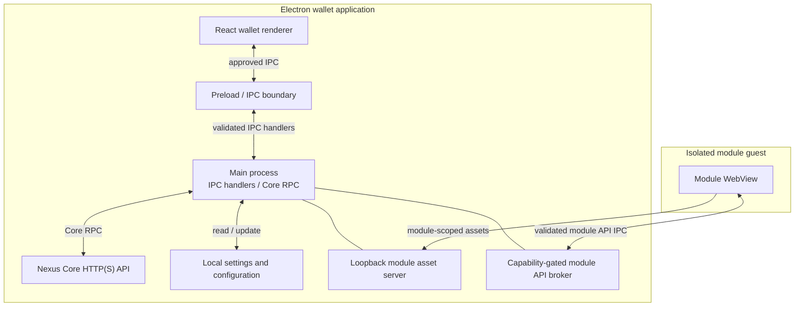

# Application architecture

The wallet UI and isolated modules use separate paths into privileged
functionality. Core API traffic is mediated by the main process.

Relevant implementation areas:

- `src/shared/lib/api.ts` and `src/main/main.js` — renderer API and IPC
- `src/main/coreRpc.js` — main-process Core transport
- `src/main/moduleFiles.js`, `src/main/webviewSecurity.js`, and
  `src/main/moduleBroker.js` — isolated module assets and broker
