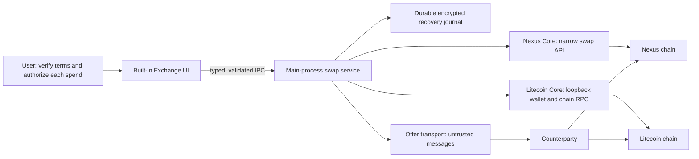
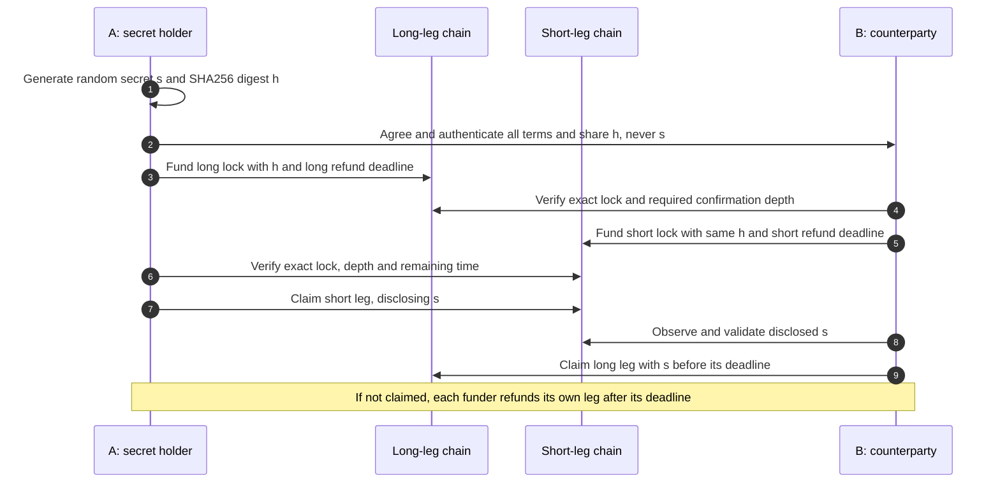
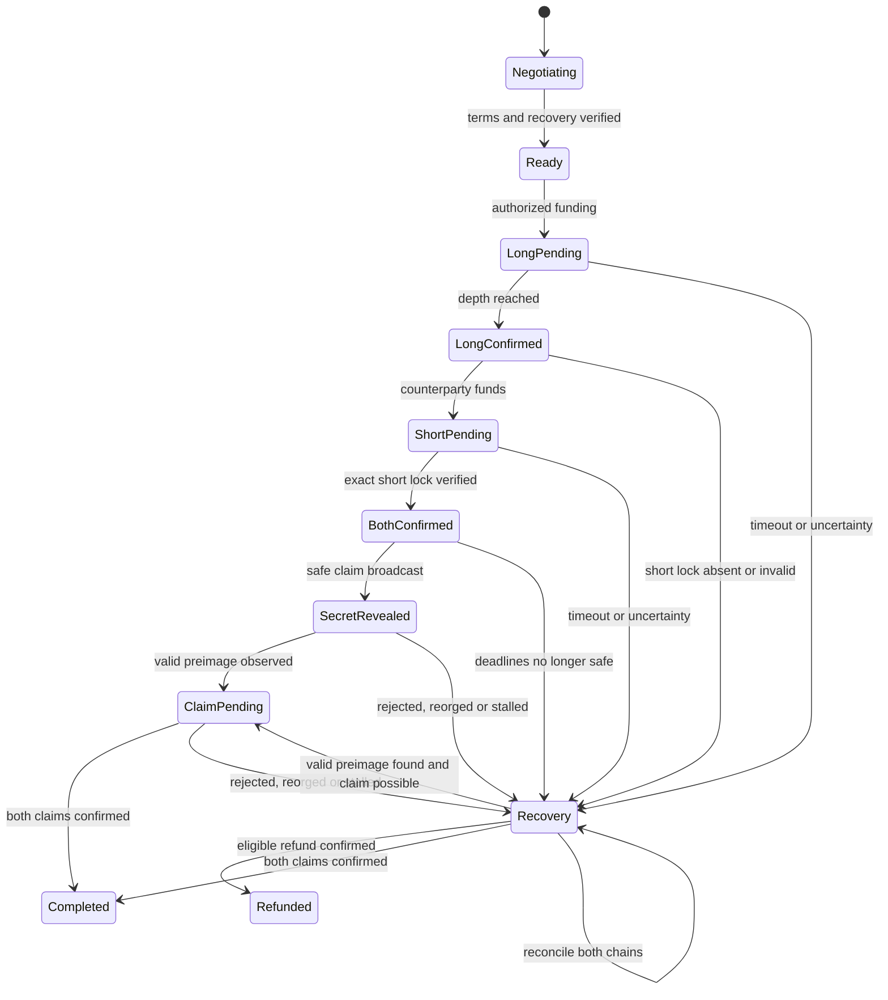

# Built-in LTC↔NXS exchange: implementation plan

> **Status:** research and proposed implementation, not a shipped feature or a
> consensus specification. Baseline: Nexus Interface `bcec3c5a` (2026-11-06);
> Litecoin Core `ec1b6489a900d09cf5991e220dce089c77a232a2`; LLL-TAO
> `NamecoinGithub/LLL-TAO` `NODE5` at `0f4a08e564caaba98afd1001ce84b94aed5a0327`
> and upstream `5.1.6` at `1185145534a20ed4d2288e4513c505f271be536d`.
> Recheck all three before implementation.
>
> **Recommendation:** start a narrowly scoped, two-chain testnet/regtest
> feasibility spike. Do not build a live exchange around an assumed Nexus
> hashlock, generic Send, or a provider deposit. Prove the exact Nexus
> consensus conditions, then integrate them through narrowly scoped APIs.

## 1. Goal and current boundary

Build a first-party exchange in Nexus Interface for a **direct, non-custodial**
LTC↔NXS swap, with both directions and user-controlled refunds. An initial
version can exchange authenticated offers manually; discovery, order books,
market makers, modules, and a custodial fallback are separate decisions.
Bitcoin is a later candidate using the same design principles, not an
automatically supported asset.

Bitcoin and Litecoin already provide Script primitives from which HTLCs can be
constructed; they do not supply a ready-made cross-chain exchange. For an
initial candidate, use a transparent Litecoin P2WSH HTLC: a beneficiary can
spend using a SHA-256 preimage and signature, while the funder can refund using
their signature after an absolute CLTV deadline. This is a **proposed** template
to validate, not production-ready Script. See [BIP 199](https://github.com/bitcoin/bips/blob/master/bip-0199.mediawiki)
(an illustrative HTLC specification, status Closed), [BIP 65](https://github.com/bitcoin/bips/blob/master/bip-0065.mediawiki),
and [Litecoin chain parameters](https://github.com/litecoin-project/litecoin/blob/ec1b6489a900d09cf5991e220dce089c77a232a2/src/chainparams.cpp)
(mainnet BIP65, CSV and SegWit activation heights). Neither Litecoin Script nor
Bitcoin Script proves that Nexus can enforce an equivalent contract.

Interface today has no Exchange route in [`src/App/index.tsx`](../../src/App/index.tsx),
nor swap operations in the [structured Core RPC registry](../../src/main/ipc/coreRpcRegistry.js).
The prior LTC monitor was reverted and the provider broker was a closed draft;
they are not current implementation. Existing [provider plans](./README.md)
describe a different, custodial deposit-address model. A provider quote is not
proof of settlement, and a normal Send confirmation cannot safely authorize
an arbitrary cross-chain contract.

### Trust and safety assumptions

The counterparty can disappear, lie, reorg, censor or send malformed data. The
user trusts their own nodes, wallet/OS and reviewed software, not the
counterparty or a quote server. Atomicity is conditional on valid on-chain
contracts, adequate confirmations and time margins, chain availability, fees,
and timely monitoring/action. It is not a guarantee against extended outages,
deep reorganizations, compromised nodes, or premature secret disclosure.
Display these operational risks rather than promising risk-free swaps.

## 2. Component boundaries

| Component | Required work | Boundary |
|---|---|---|
| LLL-TAO consensus and ledger | Prove or add a consensus-enforced, one-shot NXS lock with claimant, hash preimage, owner refund, and deterministic expiry. Handle replay, concurrent claim/refund, and reorgs. | A UI check, owner-controlled register, or API-only timer is not an escrow. |
| LLL-TAO API and indexing | Expose narrowly typed creation, inspection, claim, refund and transaction/condition lookup, with unambiguous amounts, parties, preimage bytes, expiry and chain identity. | Version/capability negotiation must fail closed; proposal is not an existing API promise. |
| Litecoin Core | User-managed node and wallet, authenticated loopback RPC; chain verification, transparent HTLC funding, redeem, refund, observation and fee handling. | Keys stay with LTC Core. Do not import `wallet.dat` or expose a general-purpose renderer RPC. |
| Interface main process | Typed swap operations, policy, verification, signer orchestration, state journal and watchers; hold credentials and secret material outside the renderer. | No caller-selected RPC method, raw URL, raw signing or arbitrary transaction broadcast. |
| Interface UI | Built-in `/Exchange`, terms/review, funding and action confirmations, status, deadlines, alerts and recovery. | UI never asserts settlement from a provider response or cached status. |
| Counterparty/transport | Negotiate a versioned offer and exchange public contract/transaction identifiers. | Authentication binds messages to the agreed terms; chain data, not messages, determines settlement. |

The existing structured [Core RPC contracts](../security/core-rpc-endpoint-registry.md)
and [`src/main/ipc/contracts.js`](../../src/main/ipc/contracts.js) are the
integration patterns. Extend their endpoint-specific schemas and tests rather
than using the developer console's URL-based escape hatch. The existing
transaction UI treats any confirmation as confirmed in
[`src/shared/lib/transactions.ts`](../../src/shared/lib/transactions.ts);
swap safety needs its own configurable, chain-specific depth and reorg-aware
watcher. The existing Send path already treats a lost mutation response as an
unknown outcome and warns against retrying; extend that principle to *every*
swap broadcast, not just ordinary sends.

### LLL-TAO findings: useful pieces, not yet an LTC HTLC

The relevant condition interpreter, opcode definitions, API expiry builder and
market-create source files have identical Git blob IDs in the pinned fork and
upstream release. The evidence below uses upstream permalinks; it does not
establish which binaries or consensus rules are active on any particular
network.

| What the source provides | What still needs proof or work |
|---|---|
| [`OP::CONDITION` applies to DEBIT and TRANSFER](https://github.com/Nexusoft/LLL-TAO/blob/1185145534a20ed4d2288e4513c505f271be536d/src/TAO/Operation/execute.cpp#L73-L94); the VM can inspect caller genesis, operations, timestamp, and ledger height/time. [`OP::VALIDATE`](https://github.com/Nexusoft/LLL-TAO/blob/1185145534a20ed4d2288e4513c505f271be536d/src/TAO/Operation/validate.cpp#L34-L50) records a validator and rejects repeat validation. | Define a condition that binds the beneficiary's signature-chain genesis and a funder's refund identity; prove that **all** claim and refund paths consume the same funds only once, including reorgs. |
| The condition VM exposes [`SK256` and `SK512`](https://github.com/Nexusoft/LLL-TAO/blob/1185145534a20ed4d2288e4513c505f271be536d/src/TAO/Operation/include/enum.h#L194-L201), not a demonstrated SHA-256 opcode. [`SK256`](https://github.com/Nexusoft/LLL-TAO/blob/1185145534a20ed4d2288e4513c505f271be536d/src/LLC/hash/SK.h#L148-L210) combines Skein and Keccak; it is **not** Litecoin's `OP_SHA256`. | A single shared SHA-256 digest cannot be checked by the cited Nexus opcodes as-is. Investigate the smallest consensus-compatible SHA-256 condition operation or another independently reviewed construction that proves both chains bind the same secret. Two unrelated digests alone do **not** prove that. |
| `CALLER::OPERATIONS` is readable by conditions, and [`CREDIT`](https://github.com/Nexusoft/LLL-TAO/blob/1185145534a20ed4d2288e4513c505f271be536d/src/TAO/Operation/credit.cpp#L139-L157) reads fixed transaction, contract, account, proof and amount fields. | No arbitrary 32-byte preimage field on a claim was established. Trace stream/operation validation and `VALIDATE` before declaring it impossible; otherwise design a bounded, consensus-validated claim witness that becomes publicly retrievable **as part of the claim**, without leaking before authorization. |
| [`AddExpires`](https://github.com/Nexusoft/LLL-TAO/blob/1185145534a20ed4d2288e4513c505f271be536d/src/TAO/API/conditions.cpp#L35-L61) uses the funding transaction timestamp plus a relative expiry and claimant transaction timestamp to allow a sender return after expiry. `expires=0` takes a different, non-expiring branch. | This is not a Litecoin CLTV height/MTP rule: caller timestamps are transaction fields, not a deadline clock, and the normal recipient clause is not a hashlock. Strict comparisons also leave the equality boundary unhandled. Prove deterministic safe deadline semantics, including backdated and future-dated transactions, client mode and reorgs, before reusing or replacing it. |
| The existing [market order](https://github.com/Nexusoft/LLL-TAO/blob/1185145534a20ed4d2288e4513c505f271be536d/src/TAO/API/commands/market/create.cpp#L146-L172) checks for another Nexus debit and has a maker clawback; [execution](https://github.com/Nexusoft/LLL-TAO/blob/1185145534a20ed4d2288e4513c505f271be536d/src/TAO/API/commands/market/execute.cpp#L140-L156) uses `VALIDATE`, `DEBIT` and `CREDIT`. | This is a same-chain token/account exchange, not proof of an LTC cross-chain HTLC. Its maker clawback is not a timed atomic-swap refund. No ready-to-use public hashlock API was established in the inspected release. |

The VM also exposes ledger time/height, but its
[client/reorganization paths](https://github.com/Nexusoft/LLL-TAO/blob/1185145534a20ed4d2288e4513c505f271be536d/src/TAO/Operation/condition.cpp#L1865-L1899)
need consensus-level investigation; do not assume they are automatically a
safe drop-in clock. A new opcode, witness format or validation rule may require
a coordinated consensus upgrade, not just an API flag. Check unmerged
development branches and deployed versions during the spike; this research
does not rule out unmerged work.

## 3. Candidate protocol and time budget

The **secret holder A funds the long-deadline leg first**; B independently
verifies it, then funds the short-deadline leg. Either asset may be the long leg:
NXS-long demonstrates one direction, LTC-long the other. The exact Nexus
condition construction remains gated on the feasibility spike.

1. Negotiate protocol version, both network/genesis identities, assets, exact
   base-unit amounts, both beneficiaries and refund identities, hash algorithm
   and digest, lock templates, deadlines, confirmations, fee limits, offer
   expiry and unique swap ID. Authenticate and bind the full transcript; reject
   replay, wrong network, changed terms and unsupported versions.
2. Before committing funds, locally reconstruct and verify each chain's
   contract and prove the user's refund path is executable without the
   counterparty. Persist the agreed terms, signing/recovery material and
   prepared operation **before** its irreversible broadcast.
3. Before B funds, verify A's exact long-leg contract, amount, parties,
   digest, expiry, unspent/unclaimed status, active-chain inclusion and depth.
   Before A reveals `s`, independently repeat these checks on B's short leg
   and verify sufficient remaining time and spendable fee budget. Do not
   accept a txid or address alone as proof.
4. B watches the short-leg spend for the actual preimage, including mempool
   observations where supported; verify `SHA256(s) == h` locally and preserve
   a valid observed preimage even if the revealing transaction is reorged.
   B claims the long leg promptly. Neither a mempool sighting nor a transaction
   submission alone is final settlement.
5. If the other leg never appears or is invalid, do not reveal the secret;
   wait and refund the funded leg when its own chain permits. Claim and refund
   can race and must be reconciled from the chain, not inferred from a timer.

### Deadlines are not interchangeable block heights

Choose a single reviewed Litecoin timeout encoding for v1 (candidate: absolute
CLTV), and establish the Nexus expiry semantics from its consensus code. Convert
each chain's actual height/time rule into a **conservative remaining-time
bound**, accounting for median-time-past where applicable; never compare
heights from different chains or use the workstation clock as consensus time.
Because block arrivals, reorgs and outages have no guaranteed upper bound, this
is a risk-based policy estimate, not a mathematical guarantee of availability.
Before A reveals `s`, require enough time for A's short-leg transaction to
propagate and confirm **before** B can refund it. Separately require the
long-leg refund to remain unavailable long enough for B to observe `s`, survive
the chosen confirmation/reorg policy, construct, fee-bump if needed, broadcast
and confirm its claim. Include node lag, block-time variance, fee spikes,
reorgs, network interruption, user authorization, and a safety margin. Stop
and present recovery instructions when either bound cannot be established.
Numeric confirmation depths and margins are **release-policy decisions** to
derive from measurements and security review, not constants established here.

The preimage can become public as soon as a redeem transaction is broadcast,
even if that transaction is rejected, replaced, never confirms or is later
reorganized. B may then claim the long leg while the short-leg claim fails.
Therefore simulate this failure explicitly, do not reveal near expiry, verify
the signed transaction and fees before broadcast, and never describe the
protocol as unconditionally atomic.

## 4. Critical upgrades before real funds

| Priority | Upgrade and evidence | Gate |
|---|---|---|
| **P0** | Nexus lock/refund consensus capability and API; see feasibility stage below. | Both directions, unauthorized spends, expiry and rollback proven; otherwise no direct settlement. |
| **P0** | Crash-safe swap journal and backup/restore. Existing renderer settings persistence in [`settings/index.ts`](../../src/shared/lib/settings/index.ts) is for settings, not a secret-bearing transaction log. | Durably record terms, network/identity, state, chain observations, tx/outpoint or Nexus contract IDs, deadlines and recovery material before action; restart/reconcile without double funding. Protect secret and signed material with a platform-appropriate encrypted store, restrictive permissions and explicit backup/export recovery; never log it. Test key loss and restore, and explain what the OS key store does not protect against. |
| **P0** | Main-process transaction policy and least-privilege node transport. | Typed per-action IPC, selected wallet and network, explicit user review, credential redaction, deadlines, payload limits, idempotency/reconciliation; deny arbitrary RPC and raw transaction requests from renderer or modules. |
| **P0** | Reliable chain observation and recovery while the app is closed, asleep, locked, offline or restarted. | Document that an idle/closed wallet is not a watchtower; give urgent notifications, explicit manual recovery/export and an independently reviewable monitoring option. No background service may silently claim it is always online. |
| **P0** | Exact money, network and lifecycle handling. | Decimal strings/base-unit integers end-to-end, precision and overflow checks; verify actual node chain identity, synchronization and wallet selection; prevent conflicting Core network/profile changes during active swaps or support safe rebind and reconciliation. |
| **P1** | Review Litecoin RPC design and real wallet behavior. | Read-only connectivity first; separately review wallet writes, transaction construction, selected wallet, unlock scope, fees, pruning/index and supported LTC Core versions. Prove signing for the custom script rather than assuming generic wallet signing handles it. |
| **P1** | Harden supply chain and repeatable cross-platform releases. | Pin and verify compatible Core artifacts, provide reproducible two-node test environments, compatibility checks, CI security/build and independently reviewed release binaries. [Current CI](../../.github/workflows/security.yml) already installs dependencies and runs security tests, build and package smoke on three OSes. |
| **P2** | Overview layout, module egress and third-party quote hardening. | Required only when those optional surfaces are used. The existing [roadmap](./ROADMAP.md) tracks them; do not make a provider adapter or Overview cards a prerequisite for the direct protocol spike. |

## 5. Staged implementation and acceptance gates

Each stage is independently reviewable. Stages 0–2 can proceed in parallel
where they do not require a contract decision; funding a real network is
blocked until all release gates are satisfied.

### Stage 0 — consensus feasibility spike (next concrete work)

**Owners:** LLL-TAO + Interface maintainers. Use pinned revisions and isolated
Nexus test/private network plus Litecoin regtest. Deliver a short, executable
test fixture and a reviewed decision record, not a UI or a mainnet switch.

- [ ] Trace Nexus contract construction, validation and execution through
  consensus, including byte-exact SHA-256 support, claimant authorization,
  expiry clock, refund rights, one-shot consumption and rollback. Demonstrate
  the exact operations on two independent Nexus nodes. Map each requirement to
  code/tests and the deployed network/version where it is active.
- [ ] Begin in LLL-TAO's
  [`tests/unit/TAO/Operation/conditions.cpp`](https://github.com/Nexusoft/LLL-TAO/blob/1185145534a20ed4d2288e4513c505f271be536d/tests/unit/TAO/Operation/conditions.cpp)
  and existing API/ledger tests: characterize `SK256`, expiry and `VALIDATE`;
  trace whether a valid claim can carry publicly extractable arbitrary bytes.
  Deliver a minimal SHA-256 plus claim-witness proposal with byte-order,
  resource limits and activation requirements if current operations cannot
  satisfy the shared-secret vector. Do not silently substitute `SK256`.
- [ ] Provide positive and adversarial vectors: correct/wrong secret, wrong
  claimant/refunder, early refund, boundary expiry, duplicate claim/refund,
  competing spends, reorg/replay, and failed/partial construction. Verify
  preimage availability to the opposite chain.
- [ ] Construct and spend a canonical Litecoin P2WSH candidate on regtest:
  fund, claim with preimage, and refund only after CLTV. Test wrong preimage/key,
  wrong network/amount/script, wrong locktime type/sequence, fee and dust
  constraints. Prove the selected wallet can sign both branches; if not, stop
  and design a separately reviewed signing approach that keeps LTC keys in
  LTC Core rather than extracting them.
- [ ] Produce a byte-exact common hash/preimage vector and candidate
  cross-chain transcript; specify exact time conversion, both directions, how
  to monitor the spend and preimage, and a conservative test-only timing policy.
- [ ] **Decision:** if existing Nexus primitives satisfy every invariant,
  document the exact active version and API exposure needed. Otherwise propose
  the smallest consensus/API change and activation/migration plan; no wallet
  code may emulate missing consensus with a trusted intermediary while calling
  it atomic.

**Exit:** reproducible fixtures, traceable source citations, agreed contract
and signing design, and a go/no-go for Stage 1. No test result may be inferred
solely from a successful API response.

### Stage 1 — LLL-TAO contract and API

- [ ] Implement or expose the agreed Nexus primitive and deterministic expiry;
  include chain-level authorization and atomic state consumption, not merely
  a convenience API. Plan network activation/version compatibility if a
  consensus change is needed; reject unsupported nodes.
- [ ] If the spike confirms the gaps, specify and implement bounded SHA-256
  verification and a claim witness readable by the condition VM; test
  consensus serialization, cost limits, domain/length rules, public
  availability and activation on old and upgraded nodes. Both parties must
  verify the same byte-exact digest; approval is conditional on review.
- [ ] Add narrow create/inspect/claim/refund and status/lookup operations with
  explicit schemas, session handling, exact base-unit amounts and redacted
  errors. A claim must publish an extractable preimage. Specify how lite and
  full nodes obtain and verify transaction/condition history. Support durable
  prepare/sign/submit or an equivalent way to identify and reconcile an
  operation after an unknown response; do not rely on blind retries.
- [ ] Run consensus and API tests on separate nodes, including competing
  operations, reorg/rollback and upgrade boundaries. Deliver protocol test
  vectors to the Interface and independent reviewers.

**Exit:** contract invariants enforced by the network, versioned and tested,
with both a viable claim and refund in the target test environment.

### Stage 2 — read-only connectivity and isolated Litecoin signer proof

- [ ] Add a main-process, loopback-only litecoind adapter with cookie
  authentication and explicit, read-only RPC allowlist. Check node network,
  genesis, sync and selected wallet; distinguish unavailable, stale and ready.
  A remote node requires an authenticated SSH tunnel **and separately
  provisioned RPC credentials**; a tunnel alone does not share the remote
  cookie. Keep credentials out of renderer, CLI arguments and logs.
- [ ] Specify and separately review the *minimum* write RPCs for funding,
  signing and broadcasting verified swap transactions; validate every
  transaction and intended output in main before authorization. Treat
  `signrawtransactionwithwallet` returning `complete` as something to verify,
  not proof that arbitrary HTLC signing is supported.
- [ ] Decide whether to use a pruned node, wallet tracking, block hash lookup,
  txindex or bounded block/mempool scans. Litecoin's
  [`getrawtransaction`](https://github.com/litecoin-project/litecoin/blob/ec1b6489a900d09cf5991e220dce089c77a232a2/src/rpc/rawtransaction.cpp#L70-L85)
  is not a general confirmed-transaction lookup without a block hash or txindex;
  a UTXO lookup alone does not reveal the spending transaction or preimage.

**Exit:** the regtest fixture works with the documented node/wallet mode and
separate read/write allowlists; transport, hostile response, timeout,
disconnect, wrong-network and locked-wallet tests pass.

### Stage 3 — persistent orchestrator and recovery

- [ ] Implement a versioned swap journal in main, scoped to network, wallet and
  profile. Store enough information to reconstruct and verify both branches;
  encrypt secrets, serialize updates, use durable atomic commits, and surface
  corruption or unavailable keys without replacing data. Define protected
  recovery export/import and test restoration on another installation.
- [ ] Use a per-swap lock and reconcile against authoritative nodes after
  restart, timeout, lost RPC response, replacement, reorg or profile switch.
  Persist intent and known transaction identity before broadcasting. Retry only
  when it is safe to rebroadcast the *same* verified transaction; never create
  a second funding transaction because a response was lost.
- [ ] Watch both legs and preimage independently of the visible screen; track
  confirmations and reversible observations, fee budgets and deadline
  warnings. Refuse unsafe progression if the chain is stale or identity changes.

This is a user-facing projection, not a complete transaction state machine.
Track each leg separately: `Completed` requires both claims at the chosen depth;
`Refunded` is terminal only after **all locally funded legs** are confirmed
refunded and no local claim remains actionable. Unknown outcomes and reorgs
can move observations backwards; retain previously revealed secrets.

**Exit:** deterministic crash-injection and two-node reorg tests demonstrate
recovery at every persisted/broadcast boundary for both directions.

### Stage 4 — built-in UI and interoperable testnet

- [ ] Add a first-party `/Exchange` route and navigation; display chain and
  wallet identities, exact amounts, rate, both fees, counterparty and contract
  details, confirmation depths, absolute deadlines, recovery readiness and
  online-monitoring warnings. Require explicit wallet-owned confirmation for
  each funding/claim/refund action and never expose secrets in the UI.
- [ ] Start with a versioned, bounded manual offer/accept exchange that binds
  identities and all terms; reject malformed, expired or changed transcripts.
  A later discovery service may relay offers but cannot dictate scripts, status
  or credentials. Decide privacy and anti-spam separately.
- [ ] End-to-end test two independent Interface instances/nodes in **both**
  directions, happy path and refund path; include invalid locks, offline
  counterparty, malformed offer, delayed confirmations, fee spikes, reorg,
  restart, sleep, wallet lock, unknown broadcast result and network mismatch.
  Run regtest first, then a confirmed compatible public testnet if available.

**Exit:** reproducible test artifacts, documented recovery drill and usable
warnings across supported platforms. Development flag only; no mainnet funds.

### Stage 5 — release gate

Independent cryptography/consensus and wallet-security review, documented
threat model and mitigations, compatible activated Nexus release, audited LTC
script/signing, stress-tested timing policy, recovery and backup drills,
packaged-app tests, user documentation and incident/rollback plan are required.
Explicitly accept residual liveness/reorg/fee risks and operational support
before enabling any capped, opt-in mainnet pilot. A feature flag is not a safety
substitute; disabling new swaps must not disable ongoing monitoring or refunds.

## 6. Open decisions and references

- Which exact Nexus conditions are enforced on the intended deployed Core
  version, and is a consensus activation needed? What transaction history and
  preimage data are available to lite nodes?
- What LTC wallet version/types can sign both branches without key export?
  Which transparent output form, node indexing and monitoring mode are supported?
- What deadlines, confirmation depths, fee reserve/bumping policy and
  confirmation authorization can be justified by test data for each chain?
- Who operates liquidity/discovery and any optional watchtower, what data is
  exposed, and what happens if each disappears? These services must not gain
  custody or become a source of consensus truth.
- How are encrypted recovery exports restored when the original OS account or
  wallet is lost? What minimum online availability is communicated to users?

Additional reference: Litecoin Core's
[`signrawtransactionwithwallet`](https://github.com/litecoin-project/litecoin/blob/ec1b6489a900d09cf5991e220dce089c77a232a2/src/wallet/rpcwallet.cpp#L3476-L3532)
documents previous-output script, witness script and amount inputs, but does
not by itself establish support for this custom HTLC. The
[existing provider capability spec](../security/exchange-capability-spec.md)
remains separate from direct atomic settlement; module access is deferred until
the first-party implementation and its own capability security review.
