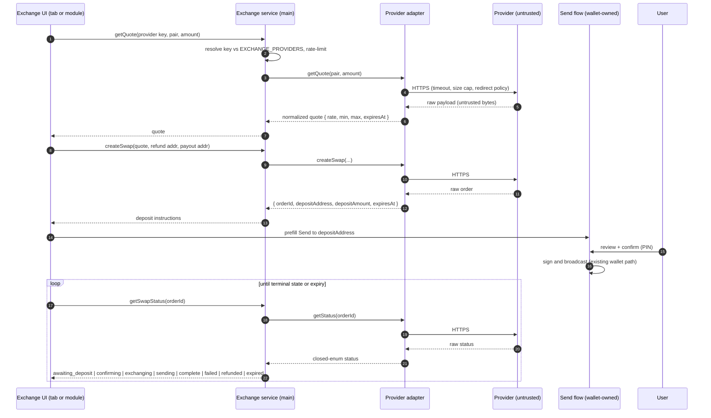

# Exchange sequences — quote → deposit → swap → settle

Decision context: [README §1 D1/D2](../README.md#1-decision-record), [README §5 provider-adapter contract](../README.md#5-provider-adapter-contract).

## 1. Provider-brokered swap (interim adapter, phase 1 tab / phase 2 module)

The ShapeShift model reborn — but provider-agnostic, main-process-only, and with funds moving exclusively through the wallet's own Send flow.

Invariants: the broker registers intent and reports status only; deposit addresses are shown for explicit user confirmation; a provider change touches the adapter, never the flow.

## 2. Direct atomic-swap proposal

The earlier conceptual sequence assumed a Nexus hashlock and refund were already
available. They must be proven against the actual consensus and API first; a
generic Send or provider deposit is not an atomic swap. See the revised
[protocol sequence, timing rules, and staged plan](../ATOMIC_SWAP_PLAN.md).
